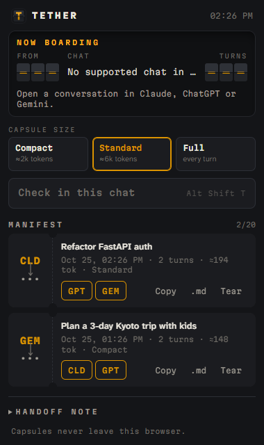
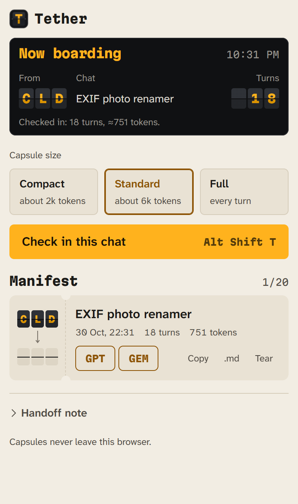
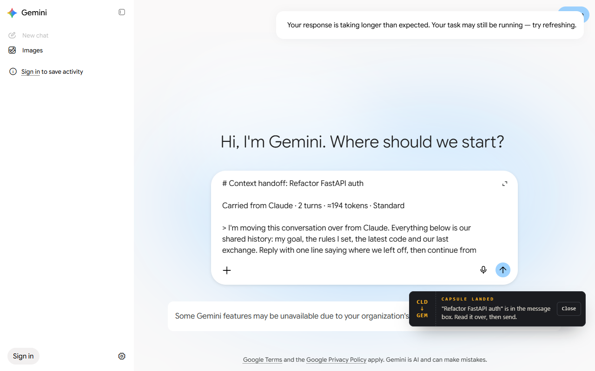

<p align="center"></p>

<p align="center"><b>Carry a conversation from one AI assistant to another, without re-explaining it.</b><br>
A Chrome extension for Claude, ChatGPT and Gemini. Everything stays in your browser.</p>

<picture>
  <source media="(prefers-color-scheme: dark)" srcset="docs/readme/trip-dark.svg">
  
</picture>

<picture>
  <source media="(max-width: 600px) and (prefers-color-scheme: dark)" srcset="https://shailesh-stats.vercel.app/api/plate?name=repo&amp;repo=tether&amp;theme=dark&amp;w=m">
  <source media="(max-width: 600px)" srcset="https://shailesh-stats.vercel.app/api/plate?name=repo&amp;repo=tether&amp;theme=light&amp;w=m">
  <source media="(prefers-color-scheme: dark)" srcset="https://shailesh-stats.vercel.app/api/plate?name=repo&amp;repo=tether&amp;theme=dark">
  
</picture>

---

You are forty messages deep in Claude, the usage cap hits, and Gemini knows nothing. Copy-pasting the thread drags in button labels, breaks code blocks and floods the new model's context. Tether reads the conversation from the page, packs it into one **capsule**, and types it into the next assistant's message box.

<p align="center">
&nbsp;&nbsp;</p>

## How it works

| Step | You | Tether |
| --- | --- | --- |
| **Check in** | Open the popup on a chat, press **Check in** (or <kbd>Alt</kbd><kbd>Shift</kbd><kbd>T</kbd>) | Reads every turn from the page, scrolling through virtualised lists so nothing is missed, and converts the rendered HTML back into Markdown |
| **Pack** | Pick Compact (~2k tokens), Standard (~6k) or Full | Builds the capsule to that budget |
| **Board** | Click the destination code: `CLD`, `GPT` or `GEM` | Opens the assistant, waits for its editor, types the capsule in. It never presses send |

### What goes in a capsule

1. A note telling the new assistant what it is reading
2. **Goal**: your first message
3. **Rules I set**: every sentence of yours with *must, never, always, don't, make sure, only…*, de-duplicated, earliest and latest kept
4. **Latest code**: the newest version of each code block (blocks with the same opening line count as revisions of one artifact)
5. **Thread so far**: your turns in full, replies cut to their opening paragraph plus their headings, newest first until the budget runs out
6. **Where we left off**: the last exchange, verbatim

The packer is deterministic and has no AI in it: the same chat always gives the same capsule. Try it on the [showcase page](site/index.html) without installing anything.

<p align="center"></p>

## Engineering notes

- **Selectors drift, so each site adapter lists the newest layout first and older ones after it.** ChatGPT's current layout drops `data-message-author-role` for signed-in users. Tether reads `data-content-search-unit-key` and falls back to the old attributes. Claude only keeps on-screen rows in the DOM, so Tether walks the list and stitches the screens together by position, which keeps genuinely repeated messages ("continue", "continue") intact.
- **Editors ignore DOM writes.** ProseMirror (Claude, ChatGPT) and Quill (Gemini) only accept text through native input. Tether tries `insertText` first, because a long *paste* can turn into a file attachment. Then it tries a synthetic paste event, and finally offers a one-click copy.
- **The hand-off goes through the service worker.** The popup closes as soon as a new tab opens, so the worker holds the capsule in `storage.session`, keyed by tab, until that tab's content script claims it.
- **Permissions:** `storage`, plus host access for the three assistants. No network requests, analytics or remote code.

## Run it

```bash
npm install     # linkedom for the tests only
npm test        # capsule budgets, DOM→Markdown, site adapters, screen stitching
```

Load it: `chrome://extensions` → Developer mode → **Load unpacked** → choose `extension/`.

The landing page in `site/` runs the extension's own packer. `npm run deploy` stages it with the files it loads into `dist/` and ships it as a Cloudflare Worker with static assets (`npx cf auth login` once first); `/` redirects to `/site/`.

## Project layout

```
extension/
  manifest.json      MV3
  src/sites.js       per-site adapters + screen stitching
  src/dom-to-md.js   rendered HTML → Markdown (lists, tables, code fences, KaTeX)
  src/capsule.js     the budgeted packer (shared with the showcase page)
  src/content.js     reads chats, types capsules
  src/stub.js        the in-page boarding-pass notice (Shadow DOM)
  src/background.js  tab hand-off
  popup/             the departure board
site/                showcase page with a live packer
test/                node:test suites with fixtures of each site's markup
```

## Design

A departure board: chats are *checked in*, capsules are *boarding passes*, sending is *boarding*. Amber split-flap characters on graphite, with a seam through every glyph and the lower half a shade deeper, as on a real Solari board. Martian Mono for the board, Atkinson Hyperlegible Next for reading. The light theme is ticket stock: the same board printed on card.

## Limits

- Supports claude.ai, chatgpt.com and gemini.google.com. When a site changes its markup, the adapter in `src/sites.js` is the one place to update. If no messages are found, selecting text on the page carries just the selection.
- Token counts are estimated at four characters per token, accurate to about ±15%.

MIT © 2026 Shailesh Upadhyay
